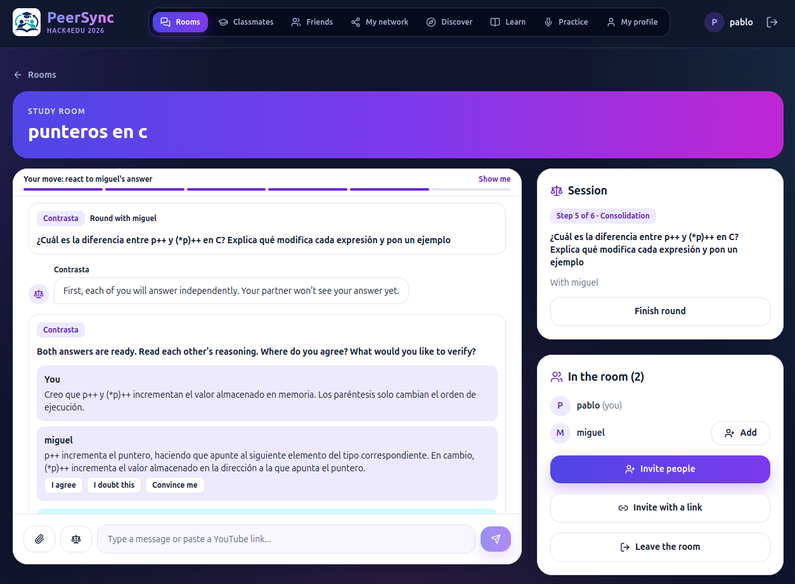
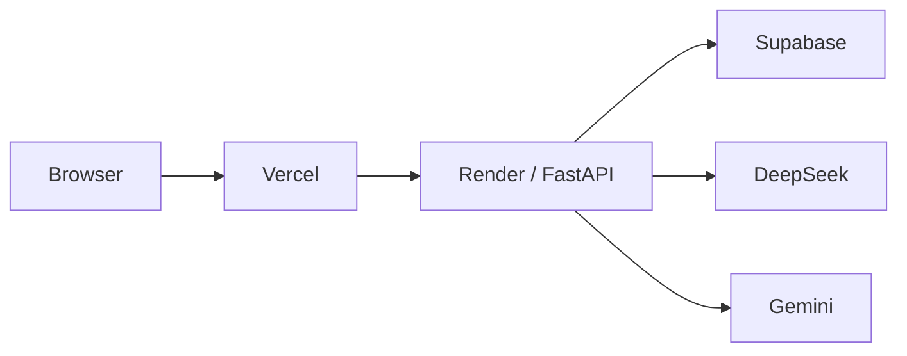

# PeerSync

**Live demo:** https://peer-sync-ashy.vercel.app

Built for Hack4Edu 2026, for the challenge on AI applied to peer learning.

## Why PeerSync

Most AI study tools replace the conversation between students with a chatbot. PeerSync does the opposite. The AI supports the conversation between peers, and the students do the thinking.

## Features

- **Contrasta:** two students answer a question on their own, then compare and discuss their answers as a pair.
- **StudyMind:** graduated hints, only when students ask.
- **TeachBack:** a student explains a concept. Classmates review it first, and AI feedback comes after.
- **Finding people:** friends, people who want to learn the same topics, and classmates from similar studies. Compatibility is calculated by deterministic rules, not by AI.

## How we built it

| Area | Technology | Deployed on |
|---|---|---|
| Frontend | React, TypeScript, Vite, Tailwind | Vercel |
| Backend | Python, FastAPI, SQLAlchemy, Alembic | Render |
| Database | PostgreSQL | Supabase |
| AI | DeepSeek for the rooms, Gemini for practice | Called only from the backend, never from the browser |

See [docs/](docs/) for the API reference and database design.
